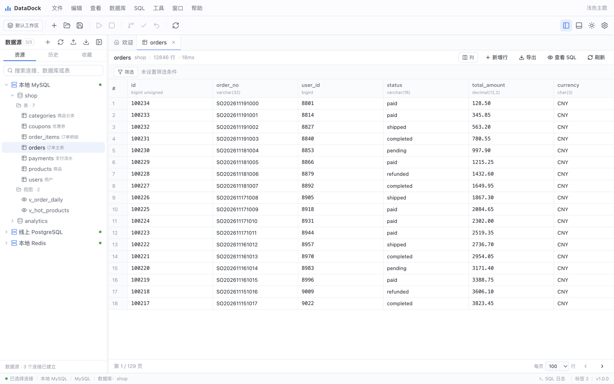
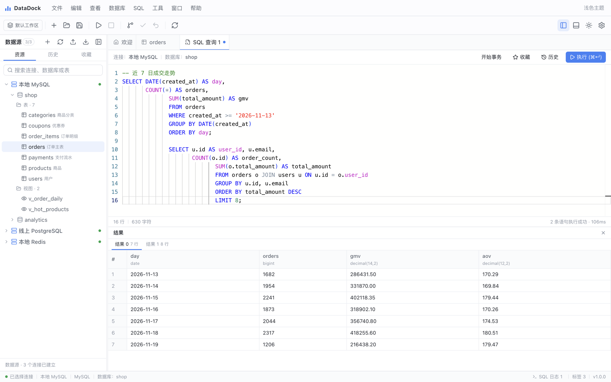
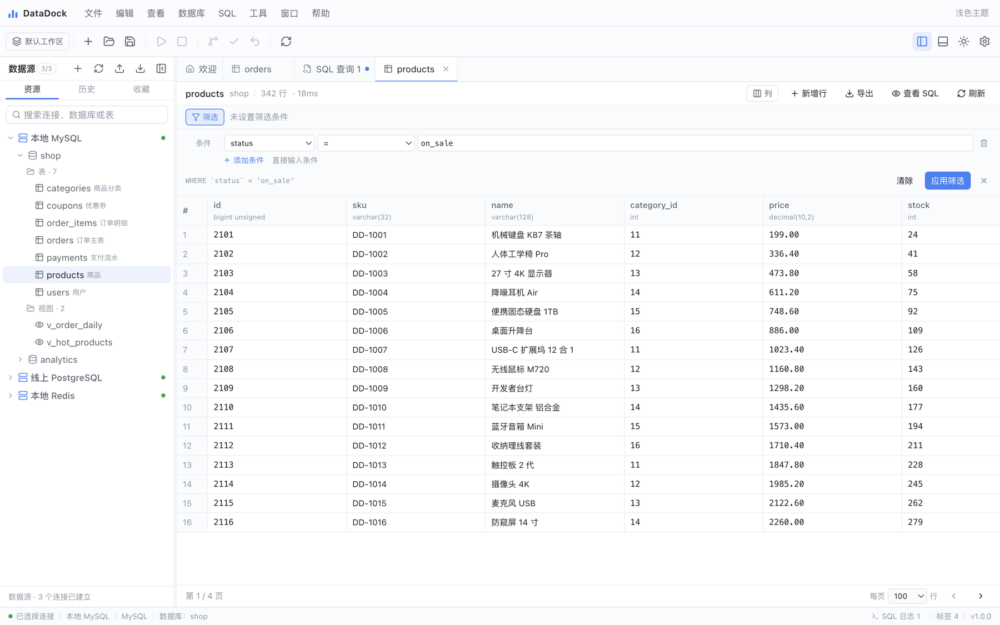
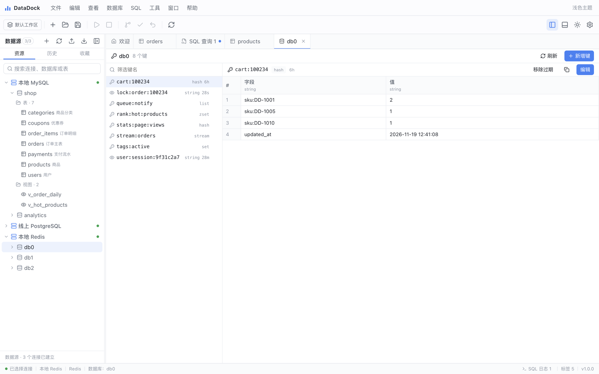
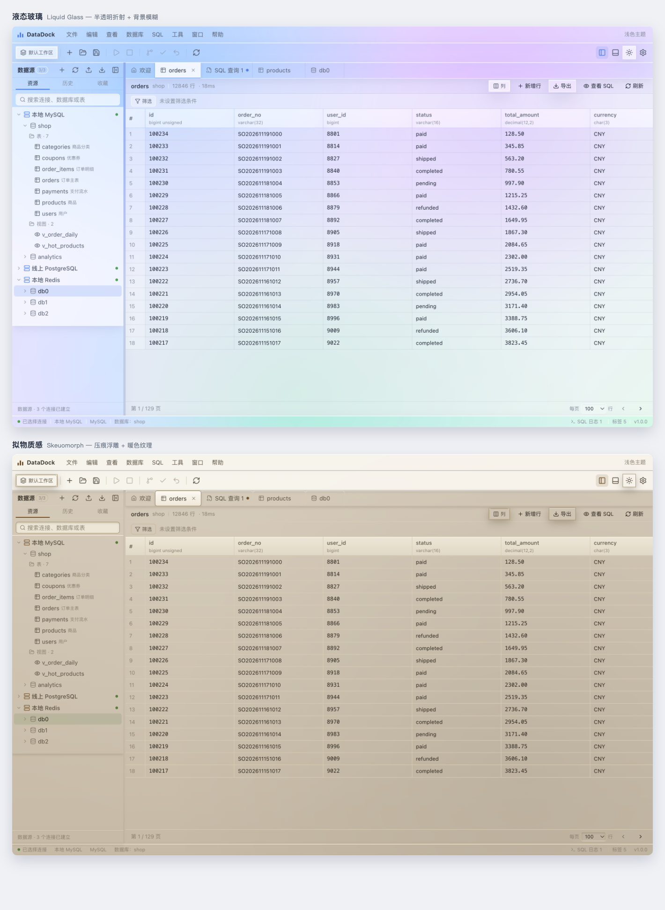

<div align="center">

# DataDock

**Your Data. One Workspace.**

轻量级、跨平台、多数据源桌面管理工具。

基于 Tauri 构建 · 支持 MySQL / PostgreSQL / Redis · 本地运行 · 不依赖云端

[](https://github.com/YOUR_USERNAME/DataDock/releases/tag/v1.0.0)
[](https://tauri.app)
[](https://vuejs.org)
[](LICENSE)

</div>

---

## 界面截图

### 主工作区（MySQL）

一个窗口管理多个数据源：左侧资源树同时挂着 MySQL、PostgreSQL、Redis，右侧按标签页打开表数据、SQL 查询与表结构。



### SQL 编辑器与查询结果

Monaco 编辑器支持多语句执行，每个语句的结果独立成页，执行耗时与命中行数即时反馈。



### 表数据浏览与编辑

分页浏览、按列筛选（条件行或直接写 WHERE）与单元格编辑，改完一次性提交。



### Redis 键浏览

按库浏览键列表，支持 string / hash / list / set / zset / stream，TTL 与内容一屏可见。



### 主题切换（液态玻璃 / 拟物）

内置液态玻璃与拟物质感两套主题，与浅色 / 深色一样全局生效，覆盖面板、按钮、弹窗与表格。



---

## 功能一览

### 数据源管理

- **多连接管理**：同时连接 MySQL、PostgreSQL、Redis，一个应用管理所有数据库。
- **连接配置持久化**：连接信息存入本地 SQLite，密码存入系统安全凭据（macOS Keychain / Windows Credential Manager / Linux Secret Service），**绝不明文存储**。
- **连通性测试**：保存前可一键测试连接是否可达。
- **SSL / SSH 隧道**：支持通过 SSH 隧道连接远程数据库，可切换密码 / 私钥认证。
- **连接导入导出**：一键导出全部连接配置为 JSON 文件，方便在多台机器间迁移（密码不导出，导入后需重新输入）。
- **连接状态实时显示**：资源树实时显示各连接的运行状态、服务器版本、当前库。

### SQL 编辑器

- **Monaco Editor**：与 VS Code 同款编辑器内核，代码补全、语法高亮、行号、错误提示一应俱全。
- **多语句执行**：一次选中或输入多条 SQL 语句，按顺序执行并分别返回结果集。
- **查询取消**：长查询可随时取消，通过 `KILL QUERY` 安全终止服务端执行。
- **多结果集**：一条语句返回多结果集时自动分 Tab 展示。
- **查询历史**：自动记录所有执行记录，支持按连接 / 关键词搜索、一键回填、一键收藏。
- **SQL 收藏**：常用 SQL 片段保存为收藏，分类管理，快速回填到编辑器。
- **SQL 文件**：打开 / 保存 `.sql` 文件，支持大文件（上限 5 MB）。
- **手动事务**：支持 `BEGIN` / `COMMIT` / `ROLLBACK`，在事务会话中执行 SQL 语句。

### 表数据浏览与编辑（MySQL / PostgreSQL）

- **分页浏览**：支持自定义每页行数，翻页、跳转、总行数显示。
- **排序**：点击列头按字段排序，默认按主键升序保证翻页稳定。
- **条件筛选**：支持自定义 `WHERE` 条件，实时生效。
- **列显示控制**：可选择显示/隐藏特定列，调整列宽（拖拽 + 持久化）。
- **行数据编辑**：双击单元格内联编辑，新增 / 修改 / 删除行，变更暂存待保存队列，一键批量提交事务。
- **数据导出**：单表导出 CSV / JSON，查询结果导出 CSV / JSON。
- **数据库导入导出**：导出整库结构 / 数据 / 结构+数据 为 SQL 脚本；从 SQL 文件导入（事务包裹，失败自动回滚）。
- **行详情**：点击行号查看整行数据，长文本 / 二进制值格式化显示。
- **表结构查看**：字段、索引、注释、建表 SQL 一屏展示，支持复制 DDL。
- **数据库 DDL 查看**：一键查看整个数据库的建库 SQL。

### PostgreSQL 支持

- **Schema 浏览**：连接后列出所有用户 Schema。
- **表 / 视图浏览**：区分物理表与视图，支持搜索。
- **SQL 执行**：复用 Monaco 编辑器，多语句支持。
- **表数据浏览**：分页 + 排序 + 条件筛选。
- **表结构**：字段、类型、可空、默认值、主键、注释完整展示。
- **数据导出**：单表 / 查询结果 CSV / JSON 导出。
- **数据库导入导出**：导出 Schema 结构+数据为 SQL 脚本；从文件导入。
- **手动事务**：`BEGIN` / `COMMIT` / `ROLLBACK` 完整支持。

### Redis 支持

- **数据库切换**：连接后可切换 db0~db15。
- **Key 浏览**：`SCAN` 渐进式扫描，支持按模式过滤。
- **类型分组**：按 String / List / Hash / Set / ZSet 分组显示。
- **值查看器**：各类型完整值展示，长值分页。
- **TTL 管理**：查看剩余生存时间，支持设置 / 移除。
- **Key 操作**：新增 / 修改 / 删除 / 重命名。
- **命令控制台**：直接执行 Redis 命令，即时返回结果。

### 主题系统

- **浅色 / 深色**：经典双色主题，跟随系统自动切换。
- **液态玻璃**：全界面半透明模糊面板 + 折射高光，柔和渐变背景，按钮/浮层/输入框统一玻璃质感。
- **拟物风格**：皮革纹理背景 + 内阴影压痕 + 渐变浮雕按钮，模拟真实物理按键手感。
- **主题持久化**：主题选择自动保存，重启后恢复。

### 其他特性

- **多标签工作区**：同时打开查询、表浏览、表结构、Redis 键等多标签页。
- **多工作区**：创建多个工作区，每个工作区独立保存标签与布局。
- **窗口记忆**：窗口尺寸 / 位置 / 面板宽度记忆，重启恢复。
- **拖拽调整面板**：侧边栏 / 结果面板宽度可拖拽调整，支持折叠。
- **状态栏**：实时显示连接状态、后端延迟、当前工作区名称。
- **SQL 操作日志**：面板显示最近 SQL 执行记录，含耗时与状态。
- **系统凭据安全存储**：密码存入操作系统安全凭据服务，SQLite 只保存 `credential_key`。
- **跨平台**：Windows / macOS / Linux 全平台支持。

---

## 技术栈

| 领域 | 技术 |
|------|------|
| 桌面框架 | Tauri 2.x |
| 前端框架 | Vue 3 + Composition API |
| 类型系统 | TypeScript |
| 构建工具 | Vite |
| 状态管理 | Pinia |
| 路由 | Vue Router（Hash 模式） |
| 后端 | Rust + Tokio |
| 数据库驱动 | SQLx（MySQL / PostgreSQL）+ redis-rs |
| 本地存储 | SQLite（SQLx 迁移） |
| 系统凭据 | keyring crate（原生实现） |
| SQL 编辑器 | Monaco Editor |
| 图标库 | Lucide |
| 测试 | Vitest（前端）+ cargo test（后端） |

---

## 项目结构

```
DataDock/
├── src/                          # 前端源码
│   ├── api/                      # Tauri IPC 封装
│   ├── components/
│   │   ├── common/               # 通用组件（按钮/输入/弹窗/菜单/Toast等）
│   │   ├── layout/               # 布局组件（菜单栏/工具栏/侧边栏/标签页/状态栏）
│   │   ├── database/             # 数据库相关（连接树/连接对话框/导入导出对话框）
│   │   ├── query/                # SQL 编辑器 / 结果表格 / 查询历史面板
│   │   ├── sidebar/              # 侧边栏面板（历史/收藏）
│   │   ├── settings/             # 设置对话框
│   │   └── table/                # 表数据组件（筛选/列菜单）
│   ├── views/workspace/          # 主工作区视图 + 各标签页
│   ├── stores/                   # Pinia 状态管理
│   ├── styles/                   # 设计令牌 / 主题变量 / 全局样式 / 主题效果层
│   ├── types/                    # TypeScript 类型定义
│   ├── utils/                    # 工具函数
│   └── composables/              # Vue 组合式函数
│
├── src-tauri/                    # Rust 后端
│   ├── src/
│   │   ├── adapters/             # 数据源适配器（MySQL / PostgreSQL / Redis）
│   │   │   ├── mysql/            #   连接 / 查询 / 表 / Schema / 导出 / 导入导出
│   │   │   ├── pg/               #   连接 / 查询 / 表 / Schema / 导出 / 导入导出
│   │   │   └── redis/            #   连接 / 命令 / Key 操作
│   │   ├── commands/             # Tauri Command（IPC 入口）
│   │   ├── services/             # 业务逻辑层
│   │   ├── repositories/         # 数据访问层（SQLite）
│   │   ├── models/               # 数据模型（请求/响应/实体）
│   │   ├── core/                 # 连接池管理器
│   │   ├── credentials/          # 系统凭据抽象
│   │   ├── database/             # SQLite 初始化与迁移
│   │   └── utils/                # SQL 切分 / 时间 / ID 生成
│   ├── migrations/               # SQLx 数据库迁移
│   ├── Cargo.toml                # Rust 依赖
│   └── tauri.conf.json           # Tauri 配置
│
├── docs/                         # 项目文档
│   ├── 00-项目总览.md
│   ├── 01-产品需求文档.md
│   ├── ...（完整设计文档）
│   └── screenshots/              # README 界面截图
│
├── public/                       # 静态资源
├── package.json                  # 前端依赖与脚本
└── README.md                     # 本文件
```

---

## 开发环境

### 前置要求

| 工具 | 版本要求 | 说明 |
|------|----------|------|
| Node.js | ≥ 18 | 推荐使用 LTS 版本 |
| Rust | ≥ 1.77.2 | 推荐通过 [rustup](https://rustup.rs) 安装 |
| 系统依赖 | — | Tauri 各平台所需系统库，见 [Tauri 文档](https://tauri.app/v2/guides/prerequisites/) |

### 系统依赖

**macOS**：无需额外安装，Xcode Command Line Tools 即可。

**Windows**：安装 [Visual Studio Build Tools](https://visualstudio.microsoft.com/visual-cpp-build-tools/)（C++ 桌面开发工作负载）+ [WebView2](https://developer.microsoft.com/en-us/microsoft-edge/webview2/)。

**Linux**（Debian/Ubuntu）：

```bash
sudo apt install libwebkit2gtk-4.1-dev libappindicator3-dev librsvg2-dev \
  patchelf libssl-dev libgtk-3-dev libsoup-3.0-dev
```

### 克隆与安装

```bash
git clone https://github.com/Sanbingduizhang/DataDock.git
cd DataDock
npm install
```

Rust 依赖会在首次构建时自动下载并编译。

---

## 开发运行

### 启动开发模式

```bash
npm run tauri dev
```

首次运行会编译 Rust 后端（约 1-3 分钟），后续启动很快。前端热更新自动生效，修改 Vue/TS 文件无需重启；修改 Rust 代码会自动重新编译并重启应用。

### 前端独立开发（无后端）

```bash
npm run dev
```

只启动 Vite 开发服务器（`http://localhost:5173`），IPC 调用会失败——适合纯界面开发。

### 代码检查与测试

```bash
# 前端类型检查
npm run type-check

# 前端代码规范
npm run lint

# 前端单元测试（88 项）
npm run test

# 前端构建
npm run build

# Rust 代码格式检查
cd src-tauri && cargo fmt --all -- --check

# Rust 静态分析（0 警告标准）
cargo clippy --all-targets -- -D warnings

# Rust 单元测试（99 项）
cargo test --lib
```

---

## 构建发布

### 构建生产包

```bash
npm run tauri build
```

构建产物位于 `src-tauri/target/release/bundle/`，按平台生成：

| 平台 | 格式 |
|------|------|
| macOS | `.app` / `.dmg` |
| Windows | `.exe` / `.msi` |
| Linux | `.deb` / `.rpm` / `.AppImage` |

### 指定平台构建

```bash
# 仅 macOS
npm run tauri build -- --target aarch64-apple-darwin

# 仅 Windows
npm run tauri build -- --target x86_64-pc-windows-msvc

# 仅 Linux
npm run tauri build -- --target x86_64-unknown-linux-gnu
```

---

## 数据存储位置

应用本地数据存储在系统应用数据目录：

| 平台 | 路径 |
|------|------|
| macOS | `~/Library/Application Support/com.datadock.app/` |
| Windows | `%APPDATA%\com.datadock.app\` |
| Linux | `~/.local/share/com.datadock.app/` |

包含：`datadock.db`（SQLite：连接配置、查询历史、收藏、设置、工作区）、Monaco 编辑器缓存。

> **密码安全**：数据库密码存入系统安全凭据（Keychain / Credential Manager / Secret Service），SQLite 中仅保存凭据键，不存储明文密码。

---

## 路线图

- [x] **v1.0.0** — MySQL / PostgreSQL / Redis / 主题系统 / 导入导出
- [ ] 连接文件夹分组
- [ ] SQL 格式化（SQLFormatter 集成）
- [ ] ER 图自动生成
- [ ] 数据库对比与同步
- [ ] SSH 端口转发增强
- [ ] 查询性能分析（EXPLAIN 可视化）

---

## 许可证

本项目基于 [Apache License 2.0](LICENSE) 完全开源。

- ✅ 允许个人使用、学习、修改
- ✅ 允许商业使用与二次分发
- ✅ 允许创建衍生作品
- ℹ️ 修改后需保留版权声明与许可证文本
- ℹ️ 不提供任何形式的质量担保（见许可证第 7 条）

---

<div align="center">

**DataDock** — Your Data. One Workspace.

</div>
